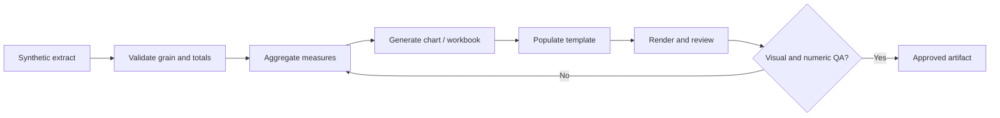

# Python for Management Reports and Presentations

Python can prepare tables, figures and draft PowerPoint slides, but **it cannot certify a presentation's accuracy or legibility by itself**. Preserve an approved presentation template, calculation contract and review evidence.

## Conceptual flow

## Common libraries

- `pandas` and `numpy` for tabular calculations; `Decimal` for exact decimal educational examples.
- `matplotlib` for reproducible figures; chart type and axes must reflect the metric.
- `openpyxl` for spreadsheet cells, formats and charts. It does not replicate all native Excel Pivot/refresh behavior.
- `python-pptx` for constructing or modifying presentation elements. Chart data and layout still require manual or automated render checks.
- `pytest` for numeric and transformation regression; browser tools are for genuinely interactive web UI, **not** for static slides.

## Refresh without breaking the baseline

1. Read the latest approved metric definition and input snapshot.
2. Validate keys, period, population and exclusions.
3. Compare source totals and independent control totals.
4. Generate a **new version** of the report; do not blindly overwrite the previous approved one.
5. Open/render every relevant slide and check clipped labels, legends, numeric formats and font substitutions.
6. Record source period, code revision, generated file checksum and any remaining QA blockers.

### Synthetic design scenario

A fictional task-progress report shows records created, records completed and completion rate by month. Its percentage is `SUM(completed) / SUM(eligible)` **at the displayed grouping level**. Do not average daily percentages or treat a missing month as zero. No real client, organizational or financial data is required for this example.

## Common traps

- A one-row-per-event extract multiplied by an unvalidated join.
- A formatted slide updated while its underlying denominator was not.
- A new chart with unreadable labels or the wrong observation period.
- A Python script that exits successfully after quietly excluding bad records.
- A workbook written with `openpyxl` and mistakenly claimed to have refreshed Excel-native Power Query/Pivot caches.

**RU:** подход к автоматизации презентаций и management reporting: Python готовит данные, графики и файлы, но формулы, источник, формат и отрисовка проходят отдельный QA.

References: [python-pptx](https://python-pptx.readthedocs.io/), [openpyxl](https://openpyxl.readthedocs.io/), [matplotlib](https://matplotlib.org/stable/).
